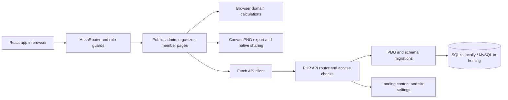

# Kumeti system review

Reviewed 10 October 2026. This document describes the current implementation, not a proposed redesign. Application code and the running development database were left unchanged. Mutation checks used a temporary API copy and disposable SQLite database, removed afterward.

## 1. Architecture

- Frontend: React 18, React Router 6, Vite 5, Tailwind 3, Lucide icons, canvas-confetti. JavaScript/JSX; no TypeScript.
- Routing: `HashRouter`, producing URLs such as `/#/org` and `/#/kameti/1`. Route guards handle login and roles in the browser; API access checks provide the server boundary.
- State: React component state plus auth, language, theme, and toast contexts. No central query cache or state store.
- API: one PHP switch router, addressed as `/api/index.php?r=route`. JSON requests and responses. Most mutation routes do not enforce HTTP methods.
- Persistence: PDO with prepared queries, SQLite for local development and MySQL for hosted installations.
- Business calculations: primarily in `src/lib/kameti.js` in the browser. The backend stores submitted payment and payout amounts rather than calculating and enforcing them independently.
- Development: Vite on port 5173 proxies `/api` to PHP on port 8000.
- Production: `npm run build` produces a static frontend and copies PHP/public assets into `dist`. PHP serves the API; production does not require a Node server.
- Integrations: WhatsApp links and the browser sharing API. No payment processor, messaging service, queues, or background scheduler.

## 2. Roles and screens

| User | Screens and capabilities |
| --- | --- |
| Visitor | Landing page, login, organizer registration; English/Urdu and light/dark switching |
| Super admin | Global statistics, user creation/editing/deletion, role/status/password management, all kametis, kameti creation/editing, landing content editor, site settings, profile |
| Organizer | Dashboard, searchable/filterable kameti list, creation wizard, own kameti management, members, numbers, payments, payouts, exports, profile |
| Member | Dashboard of linked kametis, personal numbers/payment status, read access to linked kameti detail, exports, profile |

Public registration always creates an organizer. Member logins are created or linked by an organizer, or users can be created by a super admin. A person added to a kameti can remain a contact without any login.

Accounts have one role. An organizer who participates in someone else's kameti does not receive the member dashboard/access behavior for that other kameti through the normal organizer listing and role checks.

Super admins creating a kameti become its organizer themselves; there is no organizer selection or ownership transfer screen.

## 3. Domain and data model

The central distinction is **person versus number**. A kameti with N numbers has N rounds and a nominal round pot of `amount × N`; it need not have N distinct people.

| Table | Meaning |
| --- | --- |
| `users` | Login identity, password hash, role, active/disabled status, language |
| `sessions` | Random token, user reference, 30-day expiry |
| `settings` | JSON site settings, landing content, schema version |
| `kametis` | Organizer, title, type, frequency, amount per number, number count, start date, status, JSON config, notes |
| `kameti_members` | Per-kameti contact; optional link to a login user; position and legacy share/turn fields |
| `kameti_slots` | Number, member, and fractional portion; authoritative ownership model |
| `payments` | One intended paid/unpaid entry per member and round, including amount/time/note |
| `payouts` | Round-level decision, payout amount, bid discount, given flag/time/note |

Example: Ali can hold numbers 1 and 6. Sana and Usman can each hold half of number 4. Ali pays twice the base contribution each round; Sana and Usman each pay half. A payout is recorded for a whole round; individual receipts for split holders are not tracked separately.

There are eight tables. The schema has primary keys but no declared foreign keys, no uniqueness constraints for email/phone or member-round/round payouts, and no secondary indexes. SQLite foreign-key enforcement is enabled, but there are no foreign-key definitions to enforce.

Schema version 2 adds/migrates slot ownership from legacy member `turn_no/share` data. Migration runs when the database is opened. There is no versioned migration directory or migration command.

## 4. Creation and management flows

### Create a kameti

1. Pick fixed, qurandazi, boli, or zaroorat.
2. Enter name, monthly/weekly/daily frequency, start, and number of rounds. Monthly creation starts on the first of the selected month; end month derives from the number count.
3. Set contribution per number and optional rules/settings.
4. Add people by name, optional phone, and number count in half-number increments. Bulk paste supports `name, phone` lines.
5. Arrange numbered turns. Reorder holders or split a number using whole, three-quarter, two-third, half, one-third, or quarter portions.
6. Review and create; the detail page opens on Share with a success animation.

The UI requires total holdings to match the number count and each arranged number to sum to one. The server does not enforce those same invariants.

### Kameti detail

Six tabs: Numbers, Share, Payments, Payouts, Members, and Rules/Info.

- Numbers: reorder/split ownership; paid-out numbers are ordinarily locked in slot editing.
- Share: full chart and individual member PNG cards, image preview, download, native share sheet.
- Payments: select round, toggle a member paid/unpaid, mark/unmark the whole round, history grid, manual WhatsApp reminder.
- Payouts: choose/record a receiver where appropriate, bid discount, amount, given status, optional reason; edit or delete existing payout.
- Members: add/edit/delete contact, create/link login, show initial credentials, WhatsApp link.
- Rules/Info: configuration, organizer details, dates, and rules/notes.

Editing a kameti changes its general terms through a shorter wizard. Members and allocations are edited separately in the detail page. Existing contributions, number count, type, and dates can be changed even after financial records exist.

Statuses are active, paused, and completed. Recording all rounds given marks completed; removing/reversing payout completion reactivates it. Paused/completed status does not generally stop writes or freeze schedule calculations.

## 5. What each type actually implements

| Type | Implemented behavior | Important limit |
| --- | --- | --- |
| Fixed | Manually arranged ownership and payout sequence | No server-enforced immutable order |
| Qurandazi, all at once | Initial wizard shuffle in browser; subsequent server shuffle of unpaid numbers using `random_int` | Can rerun and manually reorder; no draw audit history |
| Qurandazi, every round | Server randomly swaps an eligible numbered group into the selected round; inserts an undecided/given=false payout decision | Drawing is separate from payout; only given rounds are protected in ordinary slot editing |
| Boli | Organizer selects a number, enters bid discount, chooses profit sharing with members or organizer | No live bidding, bid history, member bids, or enforced bid limits |
| Zaroorat | Organizer selects a number and can enter reason | No need requests, voting, priority engine, or required-reason validation |

Draw probability is by numbered group, including a split group, rather than by unique person. A person holding several numbers therefore has several opportunities.

Some config fields exist as defaults only: `order_basis`, `draw_in_front`, `bid_step`, `last_no_bid`, and `emergency_priority`. They do not implement the behavior their names imply.

## 6. Amounts, dates, and reporting

- Nominal pot: base contribution × number count.
- Organizer fee: rounded percentage of nominal pot, subtracted from default payout.
- Boli member discount: bid amount ÷ number count; contribution is `(base − discount) × member's total portion`, rounded to whole rupees.
- Default payout: nominal pot − organizer fee − bid amount. A nonzero recorded payout overrides this display calculation.
- Paid status: existence of a payment row, regardless of whether its recorded amount settles the due amount.
- Collection: sum of payment records. No bank reconciliation or online money movement.
- Progress: count of given payouts ÷ number count.
- Current round: calculated from start and frequency against browser date; clamped to round 1 before start and final round after end.
- Pending: expected contributions through current round minus *all* recorded contributions, including future rounds, then clamped to zero.
- Due day, grace days, and late fee are stored/displayed; they do not drive actual overdue calculations or automatic charges.
- Member dashboard and export cards use base contribution × ownership; they do not consistently reflect boli discounts shown in the payment/detail calculations.
- Dashboard volume is the sum of nominal round pots, not the sum of all contributions across every round of each kameti. Member counts sum contact rows across groups, not unique people.
- Money displays default to `Rs`, rounded to whole rupees and Indian digit grouping. API currency configuration is not wired throughout the UI and has no settings control.
- API timestamps use UTC. Schedule calculations use the browser's local date. There is no organization timezone setting.

## 7. Authentication and permissions

Passwords use PHP password hashing/verification. Tokens use 32 random bytes encoded as hex and expire after 30 days. Browser storage is `localStorage`; requests send `X-Auth-Token`. The backend also accepts a token query parameter. Logout deletes that token's session. Disabled accounts are denied; admin disabling also removes sessions.

Server access generally permits super admins, the kameti owner, and read-only member users linked by `user_id` or matching email. SQL queries are parameterized.

There is no email/phone verification, password recovery, MFA, login throttling, forced initial password change, session/device management, or revocation of all existing sessions on password change. New member passwords are six-digit generated values returned to the organizer.

Member read access returns all member/contact records, all slots, all payments, and all payouts for the group. The UI hides editing, but data access is broader than a strictly personal dashboard.

## 8. API inventory

| Area | Routes |
| --- | --- |
| Public | `ping`, `public/landing` |
| Auth | `auth/login`, `auth/register`, `auth/me`, `auth/logout`, `auth/profile` |
| Admin | `admin/stats`, `admin/users`, `admin/users/delete`, `admin/landing`, `admin/settings` |
| Kametis | `kametis`, `kametis/get`, `kametis/save`, `kametis/delete` |
| Members | `members/save`, `members/delete`, `members/login` |
| Numbers | `slots/save`, `slots/shuffle`, `slots/draw` |
| Payments | `payments/toggle`, `payments/round` |
| Payouts | `payouts/save`, `payouts/delete` |

List routes load complete lists, with client-side filtering and no pagination. Member listings perform additional per-kameti queries. Detail retrieves complete histories. Error responses can include raw exception details.

## 9. Landing, language, appearance, sharing

Landing content is JSON in settings, merged over bundled defaults. The admin editor edits bilingual hero, statistics, trust strip, features, type section visibility/text, steps, FAQs, CTA, and footer/contact content as supported by its schema. It supports preview, visibility toggles, list editing, and restoring defaults. This is a fixed-section content editor, not a general page builder.

English and Urdu use dictionary strings plus bilingual landing values. Urdu sets document direction to RTL and uses Nastaliq typography. Some text remains English (for example Copy/Close and editor field labels). Login/session restoration does not automatically apply the user's saved language; language primarily follows browser storage until a profile update.

Theme defaults to light on first visit and then follows a local stored choice. Responsive layout uses desktop sidebar and mobile bottom navigation. Shared UI includes modals, confirmation dialogs, cards, buttons, toasts, tables, and progress indicators. Modals support Escape/backdrop closing and scroll lock but lack a complete dialog/focus-management implementation.

Exports use browser canvas at 1080-pixel width; no screenshot/export library. Fonts are loaded through the browser. Native file sharing falls back to PNG download. WhatsApp reminders require the user to send the prepared message. Share links point to the site's base URL, not a membership invitation or automatic join flow.

The manifest provides standalone app metadata, but there is no service worker, offline API cache, or offline synchronization. A manifest alone does not provide a complete offline PWA.

## 10. Findings to resolve before relying on production records

### Access and identity

1. **Unverified contact-based membership.** Members can set an unused email without verification, and matching email grants group access. Organizer contact matching can also link an account based on unverified contact details. Verified identity or explicit invitations are needed if contact matching is used for access. Source: `lib.php:kameti_for`, `index.php:auth/profile`, `add_member`, `members/login`. Confirmed profile email acceptance and matching-based access in the isolated API.
2. **Member-update response can expose another group's row.** `members/save` scopes UPDATE to the authorized kameti, then SELECTs the supplied member ID without that scope. An organizer can receive a member record from a different kameti even though the update affects no row. The unscoped return was reproduced; access across different organizers follows from the same query. Source: `index.php:members/save`.
3. **Stale identity links.** Editing a member to an unlinked email keeps the previous `user_id` via `COALESCE`. The previous login can retain access after the contact changes. Source: `index.php:members/save`; code finding.
4. **Phone uniqueness is inconsistent.** Registration/admin editing check phone duplicates; profile editing does not. Duplicate phones were accepted in the isolated API, introducing ambiguous login/linking behavior.
5. **Demo accounts persist when buttons are hidden.** Turning off Show Demo affects the UI only; it does not disable seeded accounts or change their known passwords. Login defaults to showing buttons while settings load and on request failure. The default credentials are also bundled in frontend code.

### Record integrity

6. **Server accepts invalid financial values.** Negative payments, round 999 on a two-round kameti, and negative payout/bid amounts returned success in isolated checks. The API trusts client amounts and lacks round/amount validation on payment routes.
7. **Server accepts incomplete allocations.** Creating a two-number group with only half of one number returned success. Slot writes filter individual invalid rows but do not require every number to sum to one, prevent duplicate holders, or cap split holder count.
8. **Historical ownership can disappear.** Member deletion removes payments and slots even for a paid-out number. Reproduced a given payout remaining with no slot holder. Paid-slot locking does not cover deletion or edits to kameti terms.
9. **Multi-step writes lack transactions.** Creation, allocation replacement, swaps, bulk payments, payout replacement, settings replacement, and deletion can partially apply. Concurrent requests can lose edits or duplicate logical records; missing database uniqueness constraints compound this.
10. **Terms can rewrite historical meaning.** Changing amount, dates, number count, type, fees, or allocations changes calculations/display for existing records. Reducing the number count can leave records outside the schedule. No audit trail or record versioning exists.
11. **Failed password update still changes profile.** Profile fields are saved before validating the current/new password. An isolated wrong-password request returned an error but still changed the name.
12. **Financial state is a toggle ledger.** Unmarking deletes payment history; re-marking replaces dates/amounts. Partial payments, refunds, overpayments, individual split-holder payout receipts, immutable receipts, and reconciliation are absent.

### Product correctness

13. **Future groups appear due already.** Domain checks confirmed a group starting in 2099 is treated as round 1 with expected contributions today.
14. **Advance payments hide arrears.** For a future two-member group, a round-2 payment reduced pending round-1 dues even when round 1 had no payments. Pending should be computed against the relevant due rounds/obligations.
15. **Boli dues disagree across screens.** Isolated calculation: base contribution 1,000 with two numbers and bid discount 200 gives detail due 900, while member dashboard/card still displays base 1,000.
16. **Configured rules are not enforced.** Due day, late fees, grace periods, bid minimum/maximum/step, last-round no-bid, reason requirement, and priority settings do not provide a complete rules engine. Boli limits in the payout dialog are hints.
17. **Every-round draw masking is incomplete.** The Numbers tab masks undecided holders for members, but underlying API slots, personal summaries, payouts, dashboard, and chart/card exports can disclose provisional assignments. A decided but ungiven draw can also be rearranged through ordinary slot editing because locking checks `given`.
18. **Monthly date overflow.** A domain check for 31 January 2026 gave 2 March for round 2. Normal monthly wizard creation avoids this by using day 1, but the API accepts other start days and validates only the date's string shape, not calendar validity.
19. **Errors can look like empty successful data.** Several dashboards/lists turn API failures into empty arrays/zero statistics. Auth restoration clears the token on any request failure. Some mutations lack busy/duplicate-click protection.

### Operations and maintenance

20. **No automated project test suite or lint script.** Build and PHP syntax checks are available; behavioral regression coverage is absent.
21. **Dependency audit reports 11 affected packages:** six high, five moderate. Many affect development/build tooling; the router advisory concerns SSR hydration, which this HashRouter app does not use. These counts alone do not establish exploitability in the deployed app. No dependency updates were made.
22. **No backup/restore, monitoring, audit log, or managed migration workflow.** These need an operating plan before real records are entrusted to the deployment.
23. **Installation starts with public setup and known demo users.** First setup is unauthenticated while no config exists. All three seeded demo accounts need treatment in a real deployment; changing only the admin password leaves the other demo credentials active.
24. **Deployment protection has a SQLite gap.** The GitHub action cleans the deployed branch and excludes `kumeti-config.php` only. The recommended MySQL data lives outside the files, but a SQLite file within the deployed directory would not receive this exclusion.

## 11. Deployment and verification

Hosting flow: push main → GitHub Action installs/builds → publishes dist to `hostinger` branch → Hostinger deploys that branch → installer connects database and saves PHP config one directory above web root where writable. Fallback config location is inside `api`. The config file and local SQLite database are ignored by Git. Apache configuration disables directory listings, provides SPA fallback, and caches assets. Hosted MySQL connectivity and actual Hostinger deployment were not exercised.

Completed checks:

- Production build passed: 1,608 modules; JS approximately 369 kB uncompressed / 113 kB gzip.
- All three PHP files passed `php -l`.
- All three seeded role logins worked in a disposable database.
- Anonymous detail access returned 401; member admin access and payment mutation returned 403.
- Public data and linked member detail access worked.
- Invalid-data, profile-update, deletion, and response-scoping cases above were exercised against the disposable API.
- Domain calculations exercised future starts, advance payments, boli dues, and monthly overflow.
- npm audit completed with the findings above.

Not completed: interactive browser walkthrough, mobile-device sharing/Urdu rendering/accessibility verification, MySQL integration, hosting deployment, concurrency/load testing, or exhaustive adversarial testing. This review does not claim every possible defect has been found.

## 12. Decisions for the next changes

1. Member privacy: own records only, shared schedule, or complete group transparency?
2. Account model: can the same person organize and participate, with a role switch or combined dashboard?
3. Enrollment: organizer-managed contacts, explicit invitations, verified phone/email, or self-join requests?
4. Financial record model: simple paid/unpaid tracking or partial payments, receipts, refunds, and audited corrections?
5. Rules: which fees/deadlines/bid constraints should be calculated and enforced?
6. Draw policy: final or rerunnable, member visibility before draw, and required draw history?
7. Historical changes: what can change after the first contribution or payout, and who can authorize corrections?
8. Product scope: manually managed boli/need-based selection or member requests and competitive bidding?
9. Operations: preferred hosting/database, backups, and expected group/user scale?

Suggested implementation order: identity/access and record integrity → calculation consistency and enforced rules → confirmed workflow/UI changes → deployment and maintenance safeguards.

## 13. Main code locations

| Concern | Files |
| --- | --- |
| App boot, routes, role guards | `src/main.jsx`, `src/App.jsx` |
| API requests, session state | `src/lib/api.js`, `src/lib/auth.jsx` |
| Calculations and slot building | `src/lib/kameti.js` |
| API routes and mutations | `public/api/index.php` |
| Database, schema, sessions, access checks | `public/api/lib.php` |
| Hosted installer | `public/api/install.php` |
| Organizer wizard and operational tabs | `src/pages/org/KametiWizard.jsx`, `src/pages/org/KametiDetail.jsx` |
| Shared allocation UI | `src/components/SlotEditor.jsx` |
| Role dashboards and management | `src/pages/admin/*`, `src/pages/org/*`, `src/pages/member/MemberDashboard.jsx` |
| Landing and content editing | `src/pages/Landing.jsx`, `src/pages/admin/LandingEditor.jsx`, `src/lib/landingDefaults.js` |
| Language, theme, design | `src/lib/i18n.jsx`, `src/lib/theme.jsx`, `src/index.css`, `tailwind.config.js` |
| Image export and sharing | `src/lib/exportImage.js` |
| Build and hosting | `vite.config.js`, `public/.htaccess`, `.github/workflows/deploy-hostinger.yml` |
